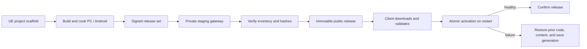

# UE Game Development Infrastructure

**A practical UE 5.8 game delivery stack: project scaffolding, signed native-and-content updates, PC/Android packaging, and a guarded release gateway.**

这是一套从真实 UE5.8 游戏项目抽取并去标识的基础设施参考实现，覆盖插件脚手架、原生更新客户端、发行清单、Windows 与 Android 构建入口、服务器发布事务和回退设计。仓库不包含游戏、地图、美术资源、引擎源码、发行包、签名材料或线上服务器配置。

## What is here

- `Tools/Scaffold/` creates a small Unreal C++ plugin skeleton without overwriting existing files.
- `Project/SampleGame/Plugins/SampleGameNativeUpdate/` contains the source-only UE plugin and Android bootstrap reference implementation.
- `Tools/Release/ReleaseSets/` contains the signed release-set contract, compatibility checks, and Windows/Android package production code.
- `Tools/Release/NativeWindows/` and `NativeAndroid/` contain native-update preparation and compatibility tooling. Production Windows keys and Android certificate pins are deliberately replaced with zero placeholders.
- `Tools/Release/PlayerHosting/` and `NativeHosting/` contain staged, hash-verified publication tools and nginx route templates. The example host is `updates.example.com`; it is not a live service.

The reference pipeline binds native binaries, cooked content, platform, channel, base build, engine identity, and save policy into one signed release. A client downloads into a private generation, checks every file, activates one code-and-content snapshot, and confirms it on the next cold start. An unhealthy or interrupted first boot returns to the prior snapshot and its matching save generation.



## Start with the plugin scaffold

Run from this repository root in PowerShell:

```powershell
pwsh -File .\Tools\Scaffold\New-UEPlugin.ps1 `
  -PluginName SampleGameplay `
  -OutputDirectory .\Project\SampleGame\Plugins\SampleGameplay
```

The script writes a descriptor, Build.cs, and minimal module source. It refuses a non-empty destination. Add the generated plugin to a UE project and build it with that project's selected engine; this public template has not been built against every UE minor version.

## Important boundaries

This repository is a **sanitized reference snapshot**, not a turnkey launcher or a promise that arbitrary C++ ABI changes can be hot-swapped. It illustrates cold-start native and content delivery for compatible installations. Engine changes, Android manifest/Java/UPL changes, signing identity changes, and unhandled save-schema changes require an explicit compatibility decision and may require a new full package.

The source project completed Development PC and Android-emulator update/recovery qualification in its own private build environment. That evidence does not automatically qualify this renamed, sanitized export, Shipping builds, physical-phone performance, 16 KiB Android devices, or historical save files. See [verification scope](docs/verification-scope.md) before using the examples for a release.

## Documentation

- [Architecture and boundaries](docs/architecture.md)
- [Update and rollback model](docs/update-and-rollback.md)
- [Packaging and publication](docs/packaging-and-publication.md)
- [Server gateway](docs/server-gateway.md)
- [Security and configuration](docs/security.md)
- [Export provenance](docs/provenance.md)
- [Verification scope and roadmap](docs/verification-scope.md)

There is no open-source license in this repository. Public visibility is for technical review; it does not grant permission to reuse or redistribute the code.
