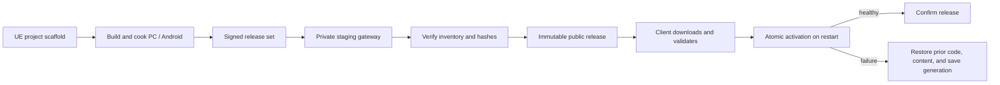

# UE Game Development Infrastructure

**Unreal Engine project scaffolding and a reference delivery pipeline for signed Windows and Android updates.**

从一个 UE 5.8 游戏项目抽取的基础设施。仓库提供可独立使用的 C++ 工程与插件脚手架，以及可在本机重现的签名、激活、回退演示。双端打包适配器与 Nginx 网关配置用于展示真实项目如何接入和交付。

## What is here

- `Tools/Scaffold/` creates a minimal Unreal C++ project or plugin and publishes the generated files together.
- `Tools/ConfigTables/` validates CSV and Excel/WPS XLSX against a schema and exports Unreal DataTable JSON with a SHA-256 manifest. `Tools/AssetChecks/` checks declared assets in a real editor session.
- `Tools/Adoption/` uses a project profile to import generated tables, check assets, Cook and launch a Win64 package in a disposable project copy.
- `Jenkinsfile` calls the same local adoption gate used by developers. It tests config export, scaffolding and offline signed updates on a Windows worker.
- `Tools/Release/ReleaseSets/demo_transaction.py` runs an offline signed release transaction with disposable files.
- `Project/SampleGame/Plugins/SampleGameNativeUpdate/` contains the source-only UE plugin and Android bootstrap reference implementation.
- `Tools/Release/ReleaseSets/` contains the signed release-set contract, compatibility checks, and Windows/Android package production code.
- `Tools/Release/NativeWindows/` and `NativeAndroid/` contain native-update preparation and compatibility tooling. Production Windows keys and Android certificate pins are deliberately replaced with zero placeholders.
- `Tools/Release/PlayerHosting/` and `NativeHosting/` contain staged publication tools and a sample HTTPS gateway with current manifests, immutable release files, and installer routes.

The reference pipeline binds native binaries, cooked content, platform, channel, base build, engine identity, and save policy into one signed release. A client downloads into a private generation, checks every file, activates one code-and-content snapshot, and confirms it on the next cold start. An unhealthy or interrupted first boot returns to the prior snapshot and its matching save generation.



## Try the scaffolds

Run from this repository root in PowerShell:

```powershell
pwsh -File .\Tools\Scaffold\New-UEProject.ps1 `
  -ProjectName ExampleGame `
  -OutputDirectory '.\local-projects\Example Game'

pwsh -File .\Tools\Scaffold\New-UEPlugin.ps1 `
  -PluginName SampleGameplay `
  -OutputDirectory '.\local-projects\Example Game\Plugins\SampleGameplay'
```

Open the generated `ExampleGame.uproject` with your installed editor. Both generators require a new destination. See [scaffold usage](Tools/Scaffold/README.md).

## Try the update transaction

From a Python 3.11+ environment with `cryptography` installed:

```powershell
python Tools/Release/ReleaseSets/demo_transaction.py
```

The demo uses the Python release store and fresh in-memory signing keys. It rejects a bad signature and altered payload, recovers the original save after an unconfirmed boot, and keeps a later confirmed release. It exercises both manifest layouts using inert fixtures.

## Important boundaries

The delivery adapters target compatible installations and activate updates on restart. A new game supplies its build and cook scripts, trusted signing identities, and a UE readiness adapter. Android's bootstrap takes over the launcher when enabled and requires embedded release metadata. See [integration prerequisites](docs/packaging-and-publication.md) and [the health contract](docs/update-and-rollback.md).

The original project's Development qualification covered Windows and an Android emulator. The public repository has its own scaffold and host checks. See [verification scope and remaining gaps](docs/verification-scope.md) for the evidence on each.

## Documentation

- [Developer adoption roadmap](docs/developer-adoption.md)
- [Config tables, asset checks and Jenkins](docs/config-and-ci.md)
- [Win64 project profile and package acceptance](docs/project-profile.md)
- [Architecture and boundaries](docs/architecture.md)
- [Update and rollback model](docs/update-and-rollback.md)
- [Packaging and publication](docs/packaging-and-publication.md)
- [Server gateway](docs/server-gateway.md)
- [Security and configuration](docs/security.md)
- [Export provenance](docs/provenance.md)
- [Verification scope and roadmap](docs/verification-scope.md)

There is no open-source license in this repository. Public visibility is for technical review; it does not grant permission to reuse or redistribute the code.
