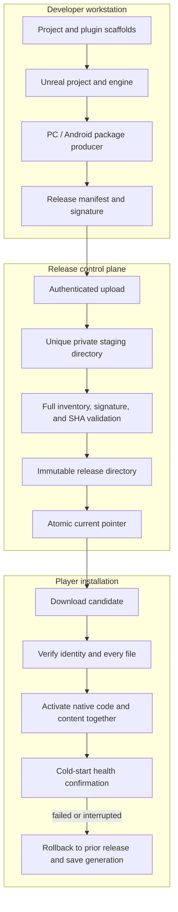

# Architecture and boundaries

The stack separates game authoring, package production, update policy, and public delivery. A release is an immutable set of native files and cooked content selected together at a cold start.

## Responsibilities

- **Scaffold** generates a minimal C++ Unreal project and optionally a separate plugin module. The project starts with stock Unreal behavior.
- **Runtime** uses the Windows launcher or Android bootstrap to verify and select files. The game supplies a UE readiness adapter to confirm the native/content/save selection.
- **Release producer:** `Tools/Release/ReleaseSets/` binds a platform package to a release identity and complete file inventory. Windows and Android builders have different archive rules, but share the release-set contract.
- **Native update producer:** `NativeWindows/` and `NativeAndroid/` prepare native payloads against a frozen base identity. The Android signing-certificate constant in this public snapshot is intentionally unusable until replaced.
- **Gateway:** hosting tools reserve a unique stage, verify uploaded bytes, promote an immutable version, and change only the intended current pointer. Nginx serves read-only manifests and versioned files; it does not accept player uploads.

## Trust boundaries

1. The installation embeds a public verification identity and a base compatibility identity. Release signing private keys stay outside the source tree and build logs.
2. The release manifest binds project, platform, channel, base release, engine identity, compatibility policy, save policy, and each payload's path, size, and SHA-256.
3. A server-side checksum is not a signature. The client verifies the signed manifest and payload inventory independently.
4. Code and cooked content are activated as one release snapshot. A failed first boot cannot leave new code selected with old content.
5. The deployment tools require a trusted operator with an SSH shell and permission to manage the release tree. The public Nginx surface serves only the configured static routes.

The repo is an extracted example. Project integrations, engine modifications, application identifiers, release trust roots, and server routes must be adapted and reviewed for each game.
